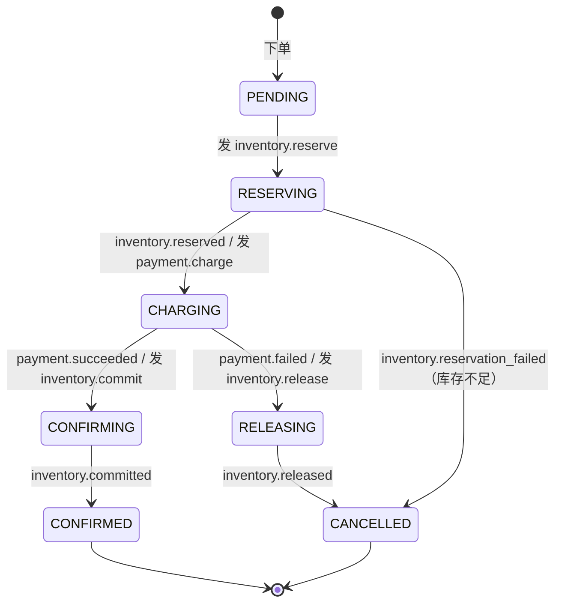
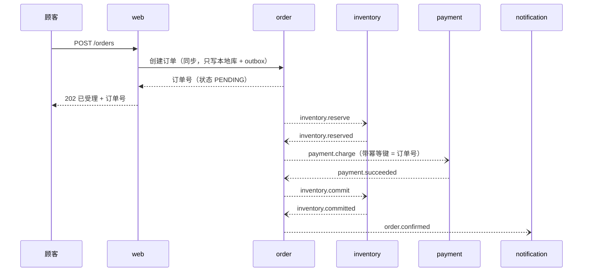

# storefront v2：微服务化设计书

> 版本 v0.2（2026-11-22）· 状态：**评审中**（本 PR 即设计评审）
> v0.2 的变更：消息中间件改为 RabbitMQ；**先利其器**：api-factory 能生成本系统 95% 的 API 之后再开始开发（工厂侧的计划：api-factory `docs/design/storefront-v2-readiness.md`）；slo-platform 的示例保持 v1。
> 目的：完整走一遍微服务的开发流程，从需求、设计、实现、测试、发布到运维，并最大化利用现有成果。

---

## 目录

0. 目标和成功标准
1. 开发流程（这次要完整走一遍的阶段）
2. 现状分析（AS-IS）
3. 需求定义
4. 基本设计：服务划分和数据归属
5. 基本设计：服务间通信
6. 详细设计：下单流程（saga）
7. 详细设计：关键机制
8. 迁移方案（从 v1 到 v2）
9. 测试计划
10. 发布和环境
11. 运维：可观测性和 SLO
12. 资源预算
13. 现有成果的利用
14. 里程碑和 PR 计划
15. 风险和待决事项

---

## 0. 目标和成功标准

**目标**：把 storefront 从"三个共享一个数据库的服务"演进成"真正的微服务"，亲手验证微服务的四个承诺。每一条都要能被测出来，而不是靠嘴说：

| 承诺 | 成功标准（可测） | 用什么证明 |
|---|---|---|
| **独立部署** | 发布任何一个服务时，其他服务零变更、零重启；用户旅程 SLO 不受影响 | 交付看板的发布记录 + SLO |
| **故障隔离** | 库存服务完全宕机时，浏览商品的可用性 ≥ 99.5%；已提交的订单不丢失 | 故障实验 |
| **最终一致** | 支付服务宕机 10 分钟后恢复，所有订单在恢复后 5 分钟内到达终态（完成或取消），没有重复扣款，没有超卖 | 故障实验 + 一致性 SLO |
| **独立扩容** | 秒杀时只扩容订单和库存服务，就能把下单拐点提高 2 倍以上 | 容量测试（capacity.py） |

**不做的**：不追求服务数量（5 个就够），不做服务网格，不做多集群，不做真实支付。

---

## 1. 开发流程

这次按一个正规团队的完整流程来走。每个阶段都有产出物和过关条件：

| 阶段 | 产出物 | 过关条件 | 用到的现有工具 |
|---|---|---|---|
| ① 需求定义 | 本设计书第 3 节 | 评审通过 | — |
| ② 基本设计 | 本设计书第 4–5 节 | 评审通过 | — |
| ③ 详细设计 | 本设计书第 6–7 节、事件契约（`contracts/`） | 评审通过；契约文件进仓库 | — |
| ④ 实现 | 每个服务的 PR | CI 绿（单元测试、lint、契约检查） | storefront 的分服务发布 CI、api-factory |
| ⑤ 单元测试 | 每个服务的 `go test` | 覆盖核心逻辑（状态机、幂等、库存扣减） | 现有 CI |
| ⑥ 集成测试 | 本地和 CI 里的 Postgres + RabbitMQ 集成测试 | 跨服务的用例全部通过 | 现有 CI 的 Postgres 服务容器 |
| ⑦ 系统测试 | dev 环境的端到端测试 + 故障实验 + 容量测试 | 第 0 节的四条标准全部过 | slo-platform 实验、capacity.py、winpc 压测机 |
| ⑧ 发布 | dev → staging → prod 晋级 | 浸泡时间 + 错误预算门槛 | 交付看板、promote 工作流、Argo CD |
| ⑨ 运维 | SLO、告警、运行手册 | 上线后一周无未解释的告警 | slo-platform、alert-speaker、手机看门狗 |
| ⑩ 复盘 | 复盘文档 + 博客 | — | — |

每个阶段的产出物都提交进仓库，评审都以 PR 的形式进行。

---

## 2. 现状分析（AS-IS）

```
用户 → web ──POST /orders──→ Postgres(orders 表) ←──抢单(FOR UPDATE SKIP LOCKED)── worker ×2
        └──GET /products──→ api（商品写死在代码里，没有数据库）
```

**做得好、要保留的：**
- 单仓库多服务，每个服务独立发布（`release-<服务>` 只在自己的目录变化时触发），独立晋级 dev → staging → prod
- 签名镜像 + Kyverno 校验；每个环境一个 CNPG Postgres，有备份
- SLO 已经覆盖页面可用性和延迟、下单、订单新鲜度和完整率；**"指标由不会随 worker 一起消失的 web 导出"**这条经验要延续
- 故障开关（`internal/fault`）、指标库（`internal/obs`）、追踪（storefront #7，待合并）

**问题（也就是 v2 要解决的）：**

| 问题 | 为什么是问题 |
|---|---|
| **共享数据库**：web 写 orders 表，worker 直接改同一张表 | 两个服务通过表结构耦合，改表必须同时改两边、同时发布，是"分布式单体"的典型特征 |
| **数据库当队列** | 能用，但没有事件，其他服务想知道"订单完成了"只能来查这张表 |
| **商品写死在代码里** | 改价格要发布代码；没有库存的概念 |
| **没有库存和支付** | 下单永远成功，体验不到跨服务一致性的问题 |

---

## 3. 需求定义

### 3.1 功能需求（用户故事）

| # | 故事 | 涉及的服务 |
|---|---|---|
| F1 | 作为顾客，我能浏览商品列表和详情（含价格、是否有货） | web、catalog、inventory |
| F2 | 作为顾客，我能下单（商品 + 数量），立刻得到订单号 | web、order |
| F3 | 下单后，系统预留库存；库存不足时订单取消，并告诉我原因 | order、inventory |
| F4 | 库存预留成功后，系统扣款；扣款失败时释放库存、取消订单 | order、payment、inventory |
| F5 | 订单完成或取消时，我收到通知 | notification |
| F6 | 我能查看自己的订单历史和每个订单的状态 | web、order |
| F7 | 运营能调整商品价格和库存数量 | catalog、inventory |
| F8 | 秒杀：限量商品在开售瞬间被大量抢购，不能超卖 | inventory、order |

### 3.2 非功能需求

| 类别 | 要求 |
|---|---|
| 一致性 | **不超卖**（库存永远不为负）；**每笔订单最多扣款一次**；**每笔订单 5 分钟内到达终态** |
| 可用性 | 浏览 99.5%；下单受理 99.5%；单个下游服务宕机时，浏览不受影响 |
| 延迟 | 页面 500ms 内（99%）；下单受理 300ms 内（99%）；订单从下单到完成 60s 内（99%） |
| 容量 | 平时：现有流量（峰值约每分钟 210 个请求）；秒杀：在 lab 上测出拐点，并验证扩容的效果 |
| 可观测性 | 一个订单从下单到通知的全过程能在一条 trace 里看到（包括异步环节） |
| 运维 | 每个服务独立发布、独立回滚；数据库变更走迁移工具，只追加 |

---

## 4. 基本设计：服务划分和数据归属

### 4.1 服务

| 服务 | 职责 | 拥有的数据 | 由谁写 |
|---|---|---|---|
| **web**（BFF） | 页面、对外入口、聚合下游数据 | 无（无状态） | 现有，改造 |
| **catalog** | 商品、价格 | `products` | 读：**api-factory 生成**；写：手写的管理接口 |
| **inventory** | 库存数量、预留、扣减、释放 | `stock`、`reservations` | 手写 |
| **order** | 订单、下单流程的编排（saga） | `orders`、`order_items`、`saga_state` | 手写；订单历史查询由 **api-factory 生成** |
| **payment** | 模拟支付（可以通过故障开关让它失败或变慢） | `payments` | 手写 |
| **notification** | 订单完成或取消时发通知（第一版只写日志和指标） | `notifications`（发送记录，用于去重） | 手写 |

现有的 `api` 演进成 `catalog`，`worker` 的职责（异步处理订单）由 order 的 saga 和各服务的事件消费者取代。

### 4.2 为什么这样划分

- 按**业务能力**划分，每个服务对应一个独立变化的原因：价格策略、库存规则、订单流程、支付渠道、通知方式，都是各自独立演进的。
- **不拆得更细**：比如"购物车"、"用户"、"配送"暂时不做。服务越多，运维成本越高，而这五个已经足以覆盖要验证的所有问题。

### 4.3 数据归属的强制手段（不靠自觉）

- 每个环境仍然只有**一个 CNPG Postgres 集群**（为了省内存），但**每个服务一个独立的数据库和一个独立的数据库账号**，账号只能访问自己的库。
- 每个服务只能拿到自己数据库的连接密钥。**跨库访问在权限上就做不到。**
- CI 检查：服务代码里不能出现其他服务的表名。

---

## 5. 基本设计：服务间通信

### 5.1 原则

| 场景 | 方式 | 例子 |
|---|---|---|
| **查询**（需要立刻得到结果） | 同步 HTTP | web → catalog（商品列表）、web → order（订单历史） |
| **状态变化**（通知别人"发生了什么"） | 异步事件 | 订单已创建、库存已预留、支付已完成…… |
| **命令**（saga 让某个服务做某件事） | 异步消息 | order → inventory："预留库存" |

**禁止**：服务之间同步地串起一个写操作（比如 order 同步调用 inventory 再同步调用 payment）。这正是"分布式单体"的根源：任何一个慢了，整条链都慢；任何一个挂了，下单就失败。

### 5.2 消息中间件：RabbitMQ（v0.2 决定）

| 候选 | 内存 | 结论 |
|---|---|---|
| NATS JetStream | 几十 MB | 轻量，但和工作经验无关 |
| **RabbitMQ** | 150MB 以上 | **采用**（用户决定）：和工作经验对齐（shinise 用的就是它）；交换机 + 队列、发布确认、消费者确认、死信交换机都是成熟的标准做法 |
| Kafka / Redpanda | 几百 MB 以上 | 对这个规模是过度设计 |

**每个集群一个 RabbitMQ 实例，每个环境一个 vhost**（dev、staging、prod 互相隔离），用 RabbitMQ Cluster Operator 部署（GitOps 管理）。单节点，队列用 classic 持久化队列；每个消费队列配死信交换机。发布端用发布确认，消费端处理成功后再确认。

### 5.3 事件格式（所有事件共用的外层）

```json
{
  "id": "evt_01J…",              // 全局唯一，用于消费者去重
  "type": "order.created",
  "version": 1,                   // 契约版本
  "occurred_at": "2026-…Z",       // 事件发生的时间（不是发送时间）
  "source": "order",
  "subject": "ord_123",           // 这个事件是关于哪个实体的
  "traceparent": "00-…",          // W3C trace 上下文：异步环节也能连成一条 trace
  "data": { … }
}
```

- 契约文件放在 `contracts/events/<type>.v<N>.json`（JSON Schema），**生产者和消费者在 CI 里都要对照契约检查**。
- **版本规则**：只能新增可选字段；要删字段或改含义时，发布新版本的事件类型，旧版本并行一段时间再下线。消费者必须忽略不认识的字段。

### 5.4 事件和命令清单

| 名称 | 类型 | 生产者 | 消费者 |
|---|---|---|---|
| `order.created` | 事件 | order | notification（可选） |
| `inventory.reserve` | 命令 | order | inventory |
| `inventory.reserved` / `inventory.reservation_failed` | 事件 | inventory | order |
| `payment.charge` | 命令 | order | payment |
| `payment.succeeded` / `payment.failed` | 事件 | payment | order |
| `inventory.release` | 命令（补偿） | order | inventory |
| `inventory.commit` | 命令（确认扣减） | order | inventory |
| `order.confirmed` / `order.cancelled` | 事件 | order | notification、web（订单状态） |

---

## 6. 详细设计：下单流程（saga）

### 6.1 选择：编排式（orchestration）

由 **order 服务充当编排者**，按状态机一步步发命令、收结果。没有选协同式（每个服务听事件各自反应）的原因：
- 订单走到了哪一步，在 order 的一张表里就能看到，**排查问题和监控都容易**；
- 补偿逻辑集中在一处，不会散落在各个服务里；
- 通知服务这类"只是听一听"的环节，仍然用协同式（订阅 `order.confirmed` 和 `order.cancelled`）。

### 6.2 状态机



### 6.3 时序（正常路径）



**下单接口只做一件事：把订单写进 order 自己的库（连同 outbox），然后立刻返回。** 后面的步骤全部异步进行，所以库存或支付变慢、宕机，都不会让下单接口变慢或失败。这就是"故障隔离"在下单路径上的具体实现。

### 6.4 超时和卡住的订单

- 每个等待中的状态都有超时（比如 RESERVING 等 30 秒）。超时后重发命令（命令是幂等的，重发安全）；超过最大重试次数，进入补偿流程。
- order 定时扫描"在某个状态停留太久"的订单，导出成指标：**卡住的订单数**和**最老的卡住时长**。这两个指标就是"每笔订单 5 分钟内到达终态"这条 SLO 的数据来源。

---

## 7. 详细设计：关键机制

### 7.1 Outbox（写数据和发事件，一个都不丢）

```
同一个数据库事务：
  INSERT INTO orders …
  INSERT INTO outbox (event_id, type, payload)
提交事务后，由 outbox 中继把 outbox 里的事件发到 RabbitMQ，发成功后标记为已发送
```

- 不会出现"订单写进去了，事件没发出去"，也不会出现"事件发出去了，订单其实没写进去"。
- 中继可能重复发送（发完还没来得及标记就崩了），所以**消费者必须去重**（见 7.2）。这就是"至少一次投递 + 幂等消费"。
- outbox 中继以库的形式放在 `internal/outbox`，每个服务都用这一份。

### 7.2 幂等消费（重复的消息只处理一次）

- 每个服务有一张 `processed_events(event_id PRIMARY KEY)`。处理消息和插入这张表放在**同一个事务**里；插入时主键冲突，说明处理过了，直接确认并跳过。

### 7.3 支付的幂等

- `payment.charge` 带上幂等键（订单号）。`payments` 表对订单号建唯一约束，重复的扣款请求返回第一次的结果，不会再扣一次。
- 这是"每笔订单最多扣款一次"的保证，故障实验会专门测重复投递的情况。

### 7.4 库存：不超卖

```sql
-- 预留：只有库存足够时才会成功（单条语句完成判断和扣减，不需要先查再改）
UPDATE stock SET available = available - $qty, reserved = reserved + $qty
 WHERE sku = $sku AND available >= $qty;
-- 影响 0 行 = 库存不足 → 发 inventory.reservation_failed
```

- 预留有过期时间：订单卡住没有确认的预留，到期自动释放，防止库存被永久占用。
- 秒杀时，热点商品的这一行会成为争抢点。容量测试要找的正是这里的拐点，然后对比"加大连接池""对热点 SKU 的请求排队"等方案的效果。

### 7.5 数据库迁移

- 每个服务用 **goose** 管理自己的表结构迁移（沿用 api-factory 的做法：只追加、启动时由 init container 执行、CI 检查漂移）。

---

## 8. 迁移方案（从 v1 到 v2）

采用**绞杀者模式**：一步一步替换，每一步上线后系统都完整可用，SLO 不中断。

| 步骤 | 做什么 | 上线后的状态 |
|---|---|---|
| S1 | 新建 catalog（`api` 改名并接数据库）；商品数据迁进 `products` 表；查询 API 由 api-factory 生成（或手写，见风险 R1） | 浏览走 catalog；其他不变 |
| S2 | 新建 order：接管 orders 表（迁到 order 自己的库），web 改为调用 order 的下单 API，不再直接写库；SLO 指标改由 order 导出（order 是常驻服务，不会随 worker 消失） | 下单走 order；worker 暂时保留 |
| S3 | 引入 RabbitMQ 和 outbox；新建 inventory 和 payment；order 实现 saga；**worker 下线** | 完整的 v2 下单流程 |
| S4 | 新建 notification；订单历史查询（api-factory） | 全部功能 |
| S5 | 异步环节的 trace 打通；一致性 SLO；故障实验和容量测试 | 第 0 节四条标准全部验证 |

每一步的 SLO（下单受理、订单新鲜度、完整率）都要保持连续。改了导出位置时，新旧指标并行一段时间再切换告警。

---

## 9. 测试计划

| 层次 | 测什么 | 怎么测 | 何时跑 |
|---|---|---|---|
| 单元测试 | 状态机的每个转移、补偿逻辑、库存扣减的边界、幂等 | `go test`，纯函数为主 | 每个 PR |
| 契约测试 | 生产者发出的事件、消费者能处理的事件都符合 `contracts/` | JSON Schema 校验，生产者和消费者两边都测 | 每个 PR |
| 集成测试 | 单个服务 + 真实的 Postgres 和 RabbitMQ：outbox 不丢、重复消息只处理一次 | CI 的服务容器 | 每个 PR |
| 端到端测试 | 完整的用户旅程：下单 → 完成 → 通知；库存不足；支付失败 | dev 环境，k6 脚本 | 发布到 dev 之后 |
| 故障实验 | 第 0 节的"故障隔离"和"最终一致"（实验清单见 11.3） | slo-platform 实验运行器，每天回归 | lab，回归时段 |
| 容量测试 | 平时的拐点、秒杀的拐点、扩容的效果 | capacity.py，从 winpc 发起 | lab，回归时段外 |

---

## 10. 发布和环境

- **环境**：dev → staging → prod 都在笔记本（生产）集群；lab（小新）复制一套用于故障实验和容量测试。
- **发布**：沿用现有的分服务发布（`release-<服务>`）：只改了某个服务的目录，就只发布那个服务。新服务各自加一个发布工作流。
- **晋级**：交付看板按服务各自晋级（已经支持 `services: [..]` 模板展开），每个服务一条流水线。
- **门槛**：dev 的端到端测试通过；staging 浸泡 5 分钟、prod 浸泡 10 分钟（沿用现有设置）；错误预算耗尽时只允许修复类发布（以后接入）。
- **回滚**：每个服务独立回滚到上一个镜像；数据库迁移只追加，所以回滚代码不需要回滚表结构。

---

## 11. 运维：可观测性和 SLO

### 11.1 SLO

| SLO | 类型 | 数据来源 |
|---|---|---|
| 浏览可用性、页面延迟 | 现有 | web |
| 下单受理可用性和延迟 | 现有，导出位置改为 order | order |
| **用户旅程：60 秒内完成订单** | 新增，latency | order（下单到 CONFIRMED 的耗时直方图） |
| **订单终态：5 分钟内到达** | 现有完整率的演进，ratio | order |
| **不超卖**（库存为负的次数 = 0） | 新增，bool | inventory |
| **不重复扣款**（同一订单扣款超过 1 次 = 0） | 新增，bool | payment |
| 各服务自己的可用性和延迟 | 新增 | 各服务 |
| outbox 积压、事件消费延迟 | 新增，age | 各服务 |

### 11.2 追踪

- 同步调用：HTTP 头传递 trace 上下文（storefront #7 已经做好）。
- 异步环节：事件外层的 `traceparent` 字段携带上下文，消费者继续同一条 trace。**一个订单从下单到通知，在一条 trace 里看完整过程。**
- Tempo 组件：slo-platform #25（部署位置待定，见风险 R3）。

### 11.3 故障实验清单（证明第 0 节的标准）

| 实验 | 预期 |
|---|---|
| inventory 全部宕机 10 分钟 | 浏览可用性不受影响；下单照常受理；订单停在 RESERVING，恢复后全部继续推进；不告警"浏览"相关的 SLO |
| payment 全部宕机 10 分钟 | 同上；恢复后 5 分钟内全部到达终态；不重复扣款 |
| RabbitMQ 宕机 5 分钟 | outbox 积压上升，恢复后排空；没有事件丢失 |
| 同一条命令被投递两次 | 只扣一次款、只预留一次库存 |
| 发布 catalog 的新版本 | 其他服务零重启；用户旅程 SLO 不受影响 |
| 秒杀（容量测试） | 不超卖；找到拐点；扩容 order 和 inventory 后拐点提高 |

### 11.4 运行手册

每个告警都有对应的处理步骤，写在 `docs/runbook.md`。沿用 slo-platform 的运行手册格式。

---

## 12. 资源预算

| 项 | 每个环境 | 说明 |
|---|---|---|
| 6 个 Go 服务 × 2 副本 | 约 12 × 20MB = 240MB | Go 服务很省内存（现有 web 约 11MB） |
| RabbitMQ | 约 150MB / **集群**（不是每个环境） | 每个环境一个 vhost |
| Postgres | 沿用现有的 CNPG 集群，只是多建几个库 | 不增加实例 |
| **合计增加** | 约 250MB / 环境 + 150MB / 集群 | |

- **笔记本**（dev + staging + prod）：增加约 900MB，内存余量充足（目前已申请的内存约 34%）。
- **小新**（lab）：增加约 900MB **放不下**。lab 只保留一套完整的 v2（或者只保留 prod 等价环境），dev 和 staging 在 lab 上缩到最小。这件事要在 Prometheus 减肥之后决定。

---

## 13. 现有成果的利用

| 成果 | 用在哪里 |
|---|---|
| **storefront 仓库** | 直接演进：单仓库多服务、分服务发布、`internal/obs`、`internal/fault`、追踪（#7） |
| **gitops-manifests**（slo-platform 实例） | 部署清单、每个服务一份 app.yaml（SLO 声明）、lab 的组件 |
| **slo-platform** | SLO 和燃烧率告警、故障实验和每日回归、容量测试（#26）、追踪组件（#25） |
| **api-factory** | catalog 的商品查询、order 的订单历史查询（风险 R1：需要先验证能否给另一个项目生成） |
| **gitops-platform-blueprint** | 共用的发布工作流（构建、签名、SBOM、推到 dev） |
| **交付看板** | 每个服务一条晋级流水线（配置模板已支持多服务） |
| **CNPG + 备份 + 恢复校验** | 每个服务的库都自动纳入备份和每日恢复校验 |
| **Kyverno** | 镜像签名校验，新服务自动适用 |
| **winpc 压测机 + capacity.py** | 秒杀容量测试，Mac 不用开着 |
| **alert-speaker + 手机看门狗** | 生产告警播报、监控系统本身的监控 |
| **goose 迁移的做法**（来自 api-factory） | 每个服务的表结构迁移 |

---

## 14. 里程碑和 PR 计划

| 里程碑 | 内容 | 过关条件 |
|---|---|---|
| **M0 设计评审** | 本设计书 + 事件契约草案 | 你的评审通过 |
| **M1 工厂就绪（先利其器）** | api-factory 补齐能力：第二个项目、JOIN、聚合、命令工厂（写入、事件、消息处理器、状态机）。计划和分母（28 个 API）见 api-factory `docs/design/storefront-v2-readiness.md` | 工厂能生成本系统 API 的 **95% 以上**（28 个里至少 27 个）并通过工厂的验证 |
| **M2 catalog（S1）** | catalog 服务 + 库 + 迁移 + 部署 + SLO | dev → prod 上线，浏览 SLO 连续 |
| **M3 order（S2）** | order 接管订单，web 不再直接写库 | 下单 SLO 连续，worker 仍在 |
| **M4 saga（S3）** | RabbitMQ、outbox、inventory、payment、saga，worker 下线 | 端到端测试通过：成功、库存不足、支付失败三条路径 |
| **M5 收尾（S4）** | notification、订单历史查询 | 全部功能需求（F1–F8）完成 |
| **M6 验证（S5）** | 追踪打通、一致性 SLO、故障实验、容量测试 | 第 0 节四条标准全部通过 |
| **M7 复盘** | 复盘文档、博客 | — |

每个里程碑一个或几个 PR，都走 CI 和晋级流程。

---

## 15. 风险和待决事项

| # | 风险或问题 | 应对 |
|---|---|---|
| **R1** | api-factory 的能力缺口很大（现在只能生成 28 个 API 中的 0 个，补上"第二个项目"后 7 个） | **v0.2 决定：先利其器**，M1 把工厂补到 95% 再开发（见 M1） |
| R2 | 小新内存不够放完整的 v2 | lab 只保留一套环境；先做 Prometheus 减肥 |
| R3 | Tempo 放在哪里（小新内存紧，放笔记本等于改生产） | M6 之前决定 |
| R4 | slo-platform 产品里的 storefront 示例要不要跟着升级 | **不升级**（v0.2 决定）：示例保持 v1 的简单形态，v2 只在我们自己的实例里 |
| R5 | ~~api-factory 配置里的本地模型仍是 qwen3.6:35b~~ | 已处理：工厂只用 Claude（api-factory #18） |

**已决定（v0.2）：** ① 范围按第 0、3 节；② 消息中间件用 RabbitMQ；③ slo-platform 的示例保持 v1；④ 先把工厂补到 95% 再开发。
